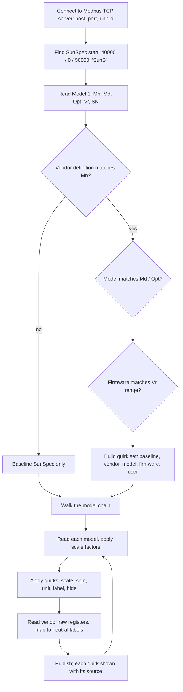
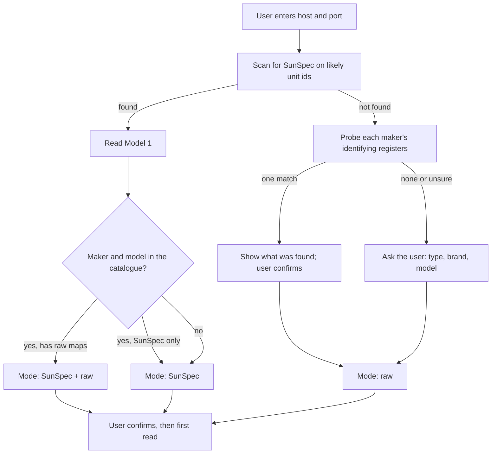

# modbus-bridge baseline design

Status: P0, agreed by the owner on 2026-11-03 (decisions D1–D5). Nothing is built yet.

Items are numbered so they can be referred to by number.

## 1. Goals

1. **Full SunSpec support.** Read every SunSpec model a device offers. Publish each point with its standard SunSpec name, units and meaning.
2. **Raw register maps as a first-class source.** Some makers are not fully SunSpec, such as Sigenergy and the GoodWe hybrids. For these, the maker's register map is defined as data: address, type, scale, word order and sign. It goes through the same quirks, neutral labels and evaluator as SunSpec data.
3. **One library for both:** `modbus-connection`, from Home Assistant's library group. It handles raw reads and writes, decoding, declarative register maps and SunSpec scanning.
4. **Quirks on top.** Where a maker or firmware does not follow SunSpec, a quirk corrects it. A quirk can change the scale, sign, unit or label, hide a point, or add a reading.
5. **Identify by Model 1.** The manufacturer (Mn), model (Md), options (Opt), firmware (Vr) and serial (SN) decide which vendor definition and quirks apply.
6. **Vendor-neutral labels** for readings outside SunSpec, so every maker's version looks the same.
7. **Import hilman2's quirks** as data, credited to their source.
8. **Every quirk is visible.** Each one is logged, shown with its source, and can be switched off.

### Target site (scope)

- The design targets the simple, common setup: **one battery system**, perhaps with AC-coupled or DC (MPPT) solar, often neither.
- We do not aim to cover every maker. A maker gets a quirk set only when there are users for it. Every other device runs on baseline SunSpec.
- Sites with several batteries, several inverters or many meters are out of scope until someone needs them.

## 2. How a device is handled

Quirks are applied in layers, lowest first. A later layer adds to an earlier one or overrides it.

| # | Layer | Matched on | Example |
|---|---|---|---|
| L1 | Baseline SunSpec | Always | M714 DCW is battery power, positive = discharge |
| L2 | Vendor | Model 1 Mn | FranklinWH: extension registers 15500+ and 16000+ |
| L3 | Model | Md, Opt | FranklinWH aGate vs aGate X |
| L4 | Firmware | Vr range | V12: WSetPct accepts only 0 to 10 % |
| L5 | User | One site | A user's own correction, shown as theirs |

## 2a. Adding a device

The device catalogue is data, with one entry for each maker and model:

| # | Field | Example |
|---|---|---|
| C1 | Maker, model, and the Model 1 text that matches them | FranklinWH aGate: Mn starts "FranklinWH", Md starts "agate" |
| C2 | Device type: battery, solar inverter, hybrid (both), meter or other | aGate: battery system |
| C3 | Mode: SunSpec, SunSpec + raw, or raw | FranklinWH: SunSpec + raw |
| C4 | How to identify it without SunSpec: the registers to probe and the values that confirm a match | A maker's model-code register |
| C5 | Connection defaults: port, unit id, word order, gap between requests, one client only | aGate: 502, unit 1, one client; Kostal: 1502, unit 71 |
| C6 | Which raw maps and quirk layers apply | FranklinWH extensions |

- The user always sees what was found and confirms it.
- An unknown device still works in SunSpec mode, as a generic battery, solar inverter or hybrid.
- Each unit id on the same address is its own device, and all share one connection that takes turns (D5).

## 2b. Quirks: when they take effect, and the user's own quirks

| # | Kind | Takes effect |
|---|---|---|
| Q1 | Shipped quirks (L2–L4) | When the app is updated, on the restart that the update causes. There are no quirk downloads between releases. |
| Q2 | User quirks (L5) | At the next reading after the user saves, with no restart. |
| Q3 | Firmware change | Model 1 is read on every connect. A new firmware rebuilds the quirk set at once, and the user is told which quirks now apply. |
| Q4 | Effect on HA | A new reading creates an entity. A hidden one is removed cleanly. A change of unit or scale to an existing reading warns the user first. |

User quirk lifecycle:

| # | Step | What happens |
|---|---|---|
| U1 | Create | Pick what to change and give a reason. The reason is required. |
| U2 | Check before saving | The quirk may only use allowed fields and sensible ranges. It must not clash with another user quirk, and its derived rules must not loop. Any new register gets a test read. |
| U3 | Preview | The current value is shown next to the new one, with what changes in HA. |
| U4 | Activate | Active from the next reading. The reading is marked "user quirk" with the reason. |
| U5 | Edit | The same checks and preview as creating. Each edit is a new version, and the previous one is kept. |
| U6 | Switch off | Any quirk, user or shipped, can be switched off without being deleted. The reading falls back to the layer below. |
| U7 | Remove | The quirk is deleted and the reading falls back to the layer below. Any entity it added is removed cleanly. |
| U8 | Audit | Every change is logged: when, who, which device, before and after, and the reason. The log is shown in the UI and can be exported. Support info lists the active user quirks. |
| U9 | Errors while running | A failing quirk gives no value, never a guess or a silent fallback. The error is logged, and the quirk is shown as failing until the user acts. |
| U10 | App update | User quirks are kept. If a shipped quirk now covers the same reading, the user's quirk still wins and the user is told. |
| U11 | Share | A user quirk can be exported with its reason and evidence, as a proposal for a shipped quirk. |

## 3. Vendor-neutral labels (non-SunSpec readings)

The FranklinWH sources are from franklinwh-modbus's published documentation.

| # | Label | Meaning | FranklinWH source |
|---|---|---|---|
| N1 | `home_load_power` | Home consumption, W | 16000 (fine) or 15506 (coarse) |
| N2 | `solar_local_power` | Solar on the local inverter, W | 15503 |
| N3 | `solar_remote_power_1`, `_2` | Solar on a remote inverter, W | 15504, 15505 |
| N4 | `solar_total_power` | All solar, W | 15502 |
| N5 | `solar_local_installed`, `solar_remote_installed` | Whether that solar input is fitted | 15500, 15501 |
| N6 | `solar_energy_total`, `solar_local_energy` | Lifetime solar energy, Wh | 15510–11, 15512–13 |
| N7 | `battery_operating_mode` | Self-consumption, time of use, backup, … | 15507: 1 emergency backup, 2 self-consumption, 3 time of use |
| N8 | `battery_reserve_active`, `_self`, `_tou` | Reserve SoC, % | 16001, 15508, 15509 |
| N9 | `battery_inverter_state` | Idle, charging, discharging, fault, … | Not yet defined. hilman2 derives it from M714 DCW and M701 InvSt |
| N10 | `grid_connection_status` | On-grid, off-grid, restarting, dispatch active, … | 15016 (values seen at one site only, unconfirmed) |
| N11 | `battery_power_fine` | Battery power at 1 W resolution | 15013, negative = charging |

Each label with a fixed set of values (N7, N9, N10) carries a plain-English description for each value.

## 3a. Constants and derived fields, evaluated at runtime

There is one vendor-independent evaluator in the core. The vendor, model and firmware layers supply data only: constants and rules. There is no maker-specific code.

- **Constants** are named values with a unit and a source, set per layer. Examples: `battery_idle_band_w = 50`, `coarse_step_w = 100`, `rating_min_plausible_w = 1000`, `rating_scale_fix = 100`.
- **Derived fields:**
  - Each rule has an output label, its inputs (points, raw registers or other labels) and a formula.
  - The formula language is small and fixed: arithmetic, comparisons, `abs`, `min`, `max`, `if … else`, set membership, and lookup tables. No general code is run.
  - Rules are ordered by their dependencies when they load, and a loop is refused.
  - A missing input gives no value, never 0.
  - A rule may remember one flag between polls.
  - Every result carries a trace of its inputs, the constants used and the rule's source.

Examples taken from the FranklinWH quirks:

| # | Output | Rule |
|---|---|---|
| R1 | `battery_inverter_state` | Idle if InvSt is in {0, 1, 6, 7}. Otherwise charging if DCW < −band, discharging if DCW > band, else idle (hilman2) |
| R2 | `home_load_power` | 16000 once it has shown a value that is not a multiple of `coarse_step_w`; until then 15506 (hilman2) |
| R3 | M702 charge/discharge rating | If 0 < value < `rating_min_plausible_w`, then value × `rating_scale_fix` (hilman2; seen on an aGate X with 2 aPower 2) |
| R4 | `grid_connection_status` | Lookup table on 15016 |
| R5 | `battery_operating_mode` | Lookup table on 15507 |

## 4. Makers

### Devices hilman2 lists (README, commit cb91e42)

| # | Maker | Devices | Type | hilman2 |
|---|---|---|---|---|
| H1 | ABB / FIMER / Power-One | Aurora, Trio, UNO, REACT | Solar inverter (REACT: hybrid) | SunSpec only |
| H2 | APsystems | ECU-R/R Pro/C with micro inverters | Micro-inverter gateway | Own quirks |
| H3 | Chint Power Systems | — | Solar inverter | SunSpec only |
| H4 | Delta | Solivia, RPI | Solar inverter | SunSpec only |
| H5 | FranklinWH | aGate with aPower | Battery system | Own quirks |
| H6 | Fronius | Symo, Primo, Eco, Galvo; Symo Hybrid; GEN24, Verto, Tauro | Solar inverter; hybrid | Own quirks |
| H7 | GoodWe | XS, DT, ET | Solar inverter; hybrid (ET) | SunSpec only |
| H8 | KACO | Powador, blueplanet | Solar inverter | SunSpec only |
| H9 | Kostal | Plenticore, PIKO IQ | Hybrid; solar inverter | Own quirks |
| H10 | SAJ | R6-T2 with eSolar AIO3 | Solar inverter | Own quirks |
| H11 | SMA | Sunny Boy, Tripower, Storage, Sunny Island, Smart Energy | Solar inverter; battery inverter; hybrid | Own quirks |
| H12 | SolarEdge | SE, HD-Wave, StorEdge, Energy Hub, Home Hub | Solar inverter; hybrid; meters | Own quirks |
| H13 | Sungrow | SG, SH | Solar inverter; hybrid | SunSpec only |
| H14 | SunPower | — | Solar | SunSpec only |

hilman2 lists no EVSE (car charger).

### Other makers (GitHub survey, 2026-11-03)

| # | Maker | SunSpec | Public documents |
|---|---|---|---|
| M1 | SolarEdge | Yes, plus its own battery and power-control registers. HA core has a `solaredge_modbus` integration. | SunSpec and Power Control technical notes. The battery registers are not public. |
| M2 | Sigenergy | SunSpec certified (SM-000055, "Sigen Inverter") for models 1, 704 and 715 only, which cover identity and control. Readings need Sigenergy's own map. | Certificate and PICS on sunspec.org |
| M3 | GoodWe | The hybrids use GoodWe's own map. Some grid-tied series may offer SunSpec (unverified). | A grid-tied protocol PDF only |
| M4 | Fronius | Yes. Model addresses shift between the float and int+SF settings. Storage is controlled through M124. HA core's `fronius` integration reads SunSpec over Modbus. | GEN24 and Tauro SunSpec maps |
| M5 | SMA | Yes, at unit id = SMA unit + 123 (126 by default). The Tripower X puts model 103 deep in the chain. | SunSpec and SMA Modbus technical documents |

## 5. Phases (one at a time)

| # | Phase | Done when |
|---|---|---|
| P0 | Baseline design | Agreed 2026-11-03 |
| P1 | Read and publish baseline SunSpec: connect, Model 1, every model, standard names | An emulated aGate and one other SunSpec device publish correctly |
| P2 | Quirk layers L2–L5, neutral labels, the evaluator (3a) and user quirks (2b), with FranklinWH first | FranklinWH extensions show under N1–N11, with every quirk visible |
| P3 | Import hilman2's quirk set for a maker, only when users need it, with credit | Each imported set loads and is credited |
| P4 | Takeover of existing integrations | The cjne takeover test is repeated with modbus-bridge |
| P5 | Bring over the FranklinWH bridge's web UI and other functions | One function at a time, each agreed first |

## 6. Decisions (owner, 2026-11-03)

- **D1.** The project is `modbus-bridge`, built on `modbus-connection`.
- **D2.** Units are published as the device reports them (W, Wh). Users can pick kW per entity in HA.
- **D3.** The neutral labels are N1–N11 as drafted. The names are reviewed when FranklinWH is built in P2.
- **D4.** The evaluator in 3a: a small fixed formula language, rules as data, and a trace on every result.
- **D5.** One HA device per unit id on the same address, all sharing one connection that takes turns. There is no HA device per SunSpec model.

## Credits

- FranklinWH register knowledge: [david2069/franklinwh-modbus](https://github.com/david2069/franklinwh-modbus) (MIT).
- Vendor quirks to be imported: [hilman2/ha-sunspec2](https://github.com/hilman2/ha-sunspec2) (MIT). Each imported file records the repo, path and commit, keeps the MIT copyright lines, and is listed in `THIRD_PARTY_NOTICES.md`.
